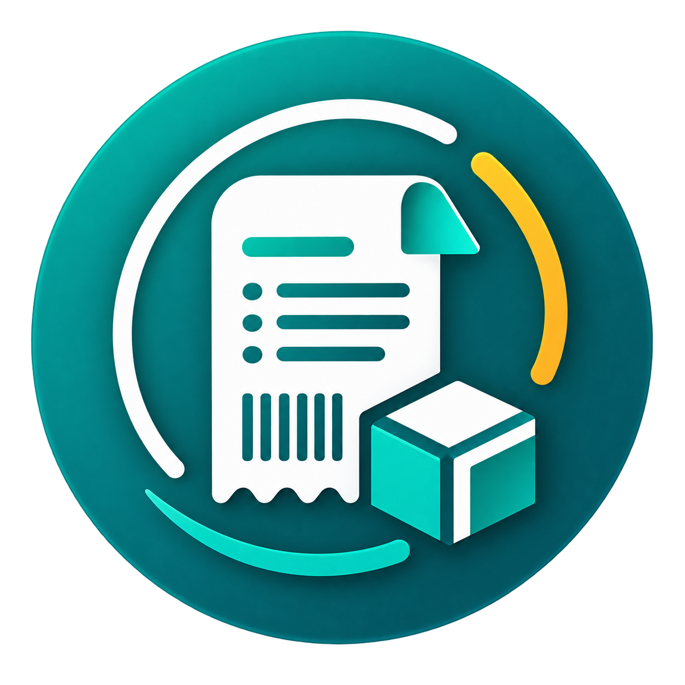
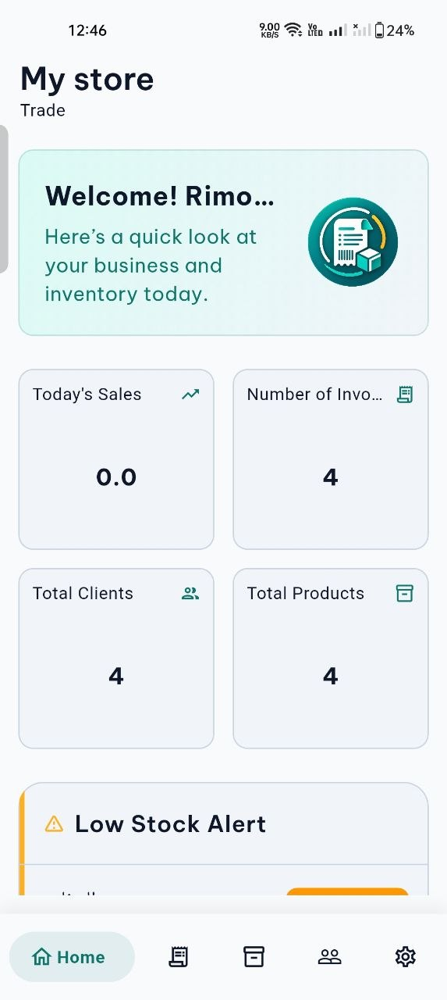
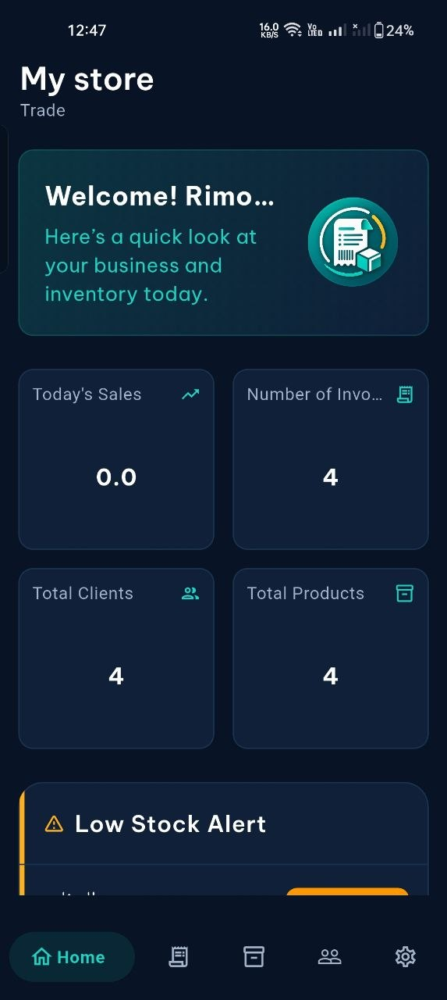
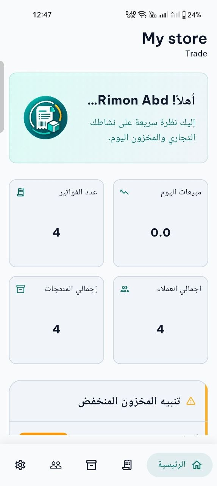
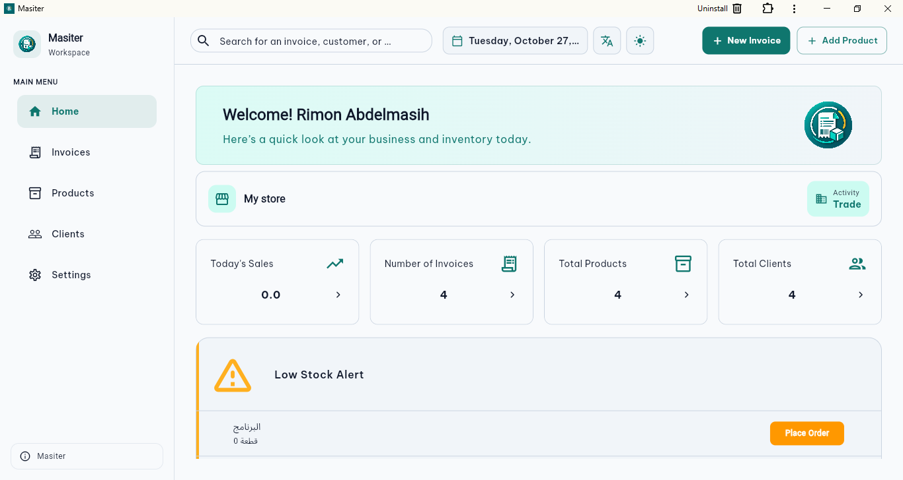

<div align="center">
  
  <h1>Masiter | مسيطر</h1>
  <p><strong>Practical business management for shops and small businesses.</strong></p>
  <p>Products, sales invoices, customers, inventory, and outstanding balances in one place.</p>
  <p>
    <a href="https://github.com/rimonnnn/Warshity/releases">APK Releases</a>
    &nbsp;•&nbsp;
    <a href="SCREENSHOTS.md">Screenshot Gallery</a>
    &nbsp;•&nbsp;
    <a href="https://rimonnnn.github.io/">Developer Portfolio</a>
  </p>
  <p>
    
    
    
    
  </p>
</div>

---

## Table of Contents

- [Overview](#overview)
- [Key Features](#key-features)
- [Screenshots](#screenshots)
- [Supported Platforms and Configurations](#supported-platforms-and-configurations)
- [Tech Stack and Architecture](#tech-stack-and-architecture)
- [Project Structure](#project-structure)
- [Getting Started](#getting-started)
- [Build](#build)
- [Download](#download)
- [Testing](#testing)
- [Design Direction](#design-direction)
- [Author](#author)
- [License](#license)
- [النسخة العربية](#arabic)

## Overview

**Masiter (مسيطر)** is a Flutter application that helps shop owners and small businesses replace scattered paper records with one organized workflow: product management, sales invoices, customer records, stock follow-up, and receivables. Data is cloud-backed, and the interface is available on mobile and web.

It supports Arabic and English, light and dark themes, and printable invoice layouts for common paper sizes. The product model is a **one-time purchase rather than a recurring subscription**.

## Key Features

### 📦 Products & Inventory

- Organize products with details such as category and unit.
- Store product images in Supabase Storage.
- Receive low-stock notifications for items that need attention.

### 🧾 Sales Invoices

- Create and manage customer sales invoices.
- Generate PDF invoices and print them in layouts designed for **58 mm** thermal, **80 mm** thermal, and **A4** paper.

### 👥 Customers & Receivables

- Keep customer details and purchase history together.
- Track customer balances and outstanding debts.
- Apply debt payments to the oldest outstanding invoice first.
- Receive morning reminders about outstanding receivables.

### 🔐 Account Access

- Register and sign in with Firebase Authentication, including an email-verification flow.

### 🌐 User Experience

- Arabic and English localization, with right-to-left layouts where applicable.
- Light and dark themes.
- Responsive layouts for mobile and web.
- Network-image caching and image error handling for smoother product browsing.

## Screenshots

Masiter across supported platforms, languages, and themes.

**[View the full screenshot gallery →](SCREENSHOTS.md)**

<p align="center">
  
  
  
  
</p>

<p align="center">
  
</p>

## Supported Platforms and Configurations

| Dimension           | Support                                         |
| ------------------- | ----------------------------------------------- |
| Platforms           | Android (APK builds) and Web (Firebase Hosting) |
| Themes              | Light and Dark                                  |
| Languages           | English and Arabic (with RTL)                   |
| Invoice print sizes | 58 mm, 80 mm, A4                                |

## Tech Stack and Architecture

| Area                               | Technologies                                   |
| ---------------------------------- | ---------------------------------------------- |
| Application                        | Flutter, Dart                                  |
| State management                   | `flutter_bloc` (BLoC/Cubit)                    |
| Navigation                         | `go_router`                                    |
| Dependency injection               | `get_it`                                       |
| Responsive UI                      | `flutter_screenutil`, `responsive_framework`   |
| Localization                       | `easy_localization`                            |
| Authentication                     | Firebase Authentication                        |
| Cloud data                         | Cloud Firestore                                |
| Product-image storage              | Supabase Storage                               |
| PDF generation & printing          | `pdf`, `printing`                              |
| Image loading                      | `cached_network_image`                         |
| Local preferences / secure storage | `shared_preferences`, `flutter_secure_storage` |
| Web hosting                        | Firebase Hosting                               |

The code separates data and presentation responsibilities: BLoC/Cubit manages UI state, and `get_it` provides service dependencies.

## Project Structure

```text
.
├── android/                 # Android platform configuration
├── ios/                     # iOS platform project
├── web/                     # Web platform files
├── lib/                     # Flutter application source
├── assets/
│   ├── images/              # App and UI assets
│   ├── fonts/               # Fonts
│   └── translations/        # Localization resources
├── docs/screenshots/        # Screenshots used by README.md and SCREENSHOTS.md
├── test/                    # Automated tests
├── firebase.json            # Firebase Hosting configuration
├── firestore.rules          # Firestore security rules
├── firestore.indexes.json   # Firestore indexes
└── pubspec.yaml             # Dependencies and Flutter configuration
```

## Getting Started

### Prerequisites

- Flutter SDK compatible with the Dart constraint in `pubspec.yaml` (`^3.10.3`)
- Git
- Android Studio or another configured Android SDK environment (for Android builds)
- Firebase and Supabase projects with the required services enabled

### 1. Clone the repository

```bash
git clone https://github.com/rimonnnn/Warshity.git
cd Warshity
```

Active development happens on the `development` branch. If your clone opens on a different branch:

```bash
git checkout development
```

### 2. Install dependencies

```bash
flutter pub get
```

### 3. Configure backend services

Make sure the Firebase and Supabase configuration matches projects you are authorized to use:

- **Firebase:** enable Authentication and Cloud Firestore for the platforms you target.
- **Supabase:** set the project URL (`<SUPABASE_URL>`) and the public client key (`<SUPABASE_ANON_KEY>`) used for product-image storage.
- Review the app's existing initialization files before changing project identifiers.

> **Security:** never place a Supabase service-role key or any server-side secret in a Flutter client, and never commit private credentials.

### 4. Run

```bash
flutter run
```

Choose a connected device or target when prompted.

## Build

**Android APK**

```bash
flutter build apk --release
# output: build/app/outputs/flutter-apk/app-release.apk
```

For smaller per-architecture APKs, use `--split-per-abi` and distribute the file matching the target device:

```bash
flutter build apk --release --split-per-abi
```

**Web**

```bash
flutter build web --release
```

With Firebase Hosting configured and the Firebase CLI installed and authenticated:

```bash
firebase deploy --only hosting
```

## Download

Published APKs are on the [GitHub Releases page](https://github.com/rimonnnn/Warshity/releases). A build appears there only after a release is created and an APK is attached.

## Testing

```bash
flutter test
```

For changes touching authentication, invoices, balances, or shared business data, test both the expected flow and relevant failure cases before releasing.

## Design Direction

A restrained teal-and-slate palette:

- **Primary teal:** `#0F766E`
- **Dark slate:** `#0F172A`
- **Light background:** `#F8FAFC`

## Author

**Rimon Abdelmasih** — Flutter Developer

[GitHub](https://github.com/rimonnnn) • [LinkedIn](https://www.linkedin.com/in/rimon-abdelmasih/) • [Portfolio](https://rimonnnn.github.io/)

Masiter has been developed collaboratively. Repository and application branding may continue to evolve.

## License

No license file is currently included. Please contact the maintainer before reusing, modifying, or redistributing this code.

---

<a id="arabic"></a>

<details>
  <summary><strong>النسخة العربية</strong></summary>

  <div dir="rtl" align="right">

  <h2>مسيطر — إدارة عملية للمحلات والمشروعات الصغيرة</h2>

**مسيطر (Masiter)** هو تطبيق مبني باستخدام Flutter لمساعدة أصحاب المحلات والمشروعات الصغيرة على تنظيم المنتجات، والمخزون، وفواتير البيع، والعملاء، والديون من مكان واحد، بدلًا من الاعتماد على السجلات الورقية المتفرقة.

  <h3>أهم المميزات</h3>

- **إدارة المنتجات والمخزون:** تنظيم المنتجات حسب بياناتها مثل التصنيف والوحدة، مع تخزين صور المنتجات ومتابعة انخفاض المخزون.
- **فواتير البيع:** إنشاء الفواتير وتصديرها بصيغة PDF وتجهيزها للطباعة بمقاسات A4 وحراري 58 مم و80 مم.
- **العملاء والديون:** حفظ بيانات العملاء ومتابعة المشتريات والأرصدة والمبالغ المستحقة.
- **تسجيل التحصيلات:** توزيع السداد على أقدم فاتورة مستحقة أولًا.
- **التنبيهات:** تنبيهات انخفاض المخزون وتذكيرات تحصيل المبالغ المستحقة.
- **مشاركة بيانات النشاط:** إتاحة مشاركة بيانات النشاط مع حساب آخر من خلال آلية مشاركة مرتبطة بالبريد الإلكتروني.
- **الحسابات:** تسجيل الدخول وإنشاء الحسابات باستخدام Firebase Authentication مع دعم التحقق من البريد الإلكتروني.
- **تجربة استخدام مرنة:** دعم العربية والإنجليزية، والوضع الفاتح والداكن، وواجهات متجاوبة للموبايل والويب.
- **نموذج الشراء:** شراء لمرة واحدة دون اشتراك دوري.

  <h3>التقنيات المستخدمة</h3>

Flutter وDart، وBLoC/Cubit لإدارة الحالة، وGoRouter للتنقل، وGetIt للحقن المعتمد، وEasyLocalization للترجمة، وFirebase Authentication وCloud Firestore للحسابات والبيانات، وSupabase Storage لصور المنتجات، ومكتبتا `pdf` و`printing` لإنشاء الفواتير وطباعتها.

  <h3>تشغيل المشروع محليًا</h3>

  </div>

```bash
git clone https://github.com/rimonnnn/Warshity.git
cd Warshity
git checkout development
flutter pub get
flutter run
```

</details>
