

  <h1>Masiter | مسيطر — Screenshot Gallery</h1>
  
<a href="README.md">← Back to README</a>

Screenshots are grouped by **platform → language → theme**. Expand a section to browse it.

| Platform | Language | Theme |
|:--|:--|:--|
| [📱 Mobile](#-mobile) | English / Arabic | Light / Dark |
| [🖥️ Web](#️-web) | English / Arabic | Light / Dark |

---

## 📱 Mobile

### English

<strong>☀️ Light Mode</strong>

 

<table align="center">
  <tr>
    <td align="center"> <strong>Dashboard</strong></td>
    <td align="center">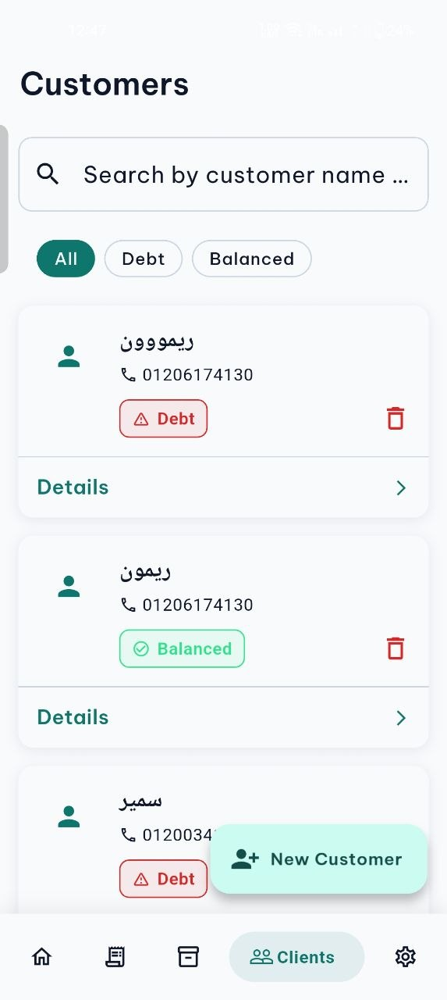 <strong>Clients</strong></td>
    <td align="center"> <strong>Invoices</strong></td>
  </tr>
  <tr>
    <td align="center">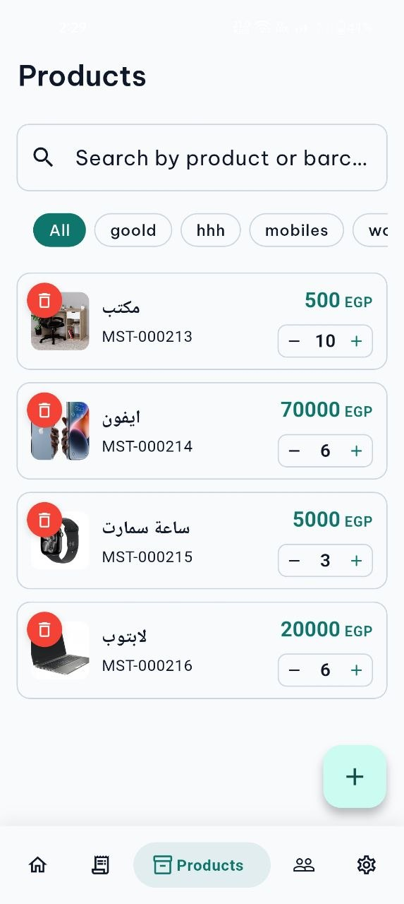 <strong>Products</strong></td>
    <td align="center">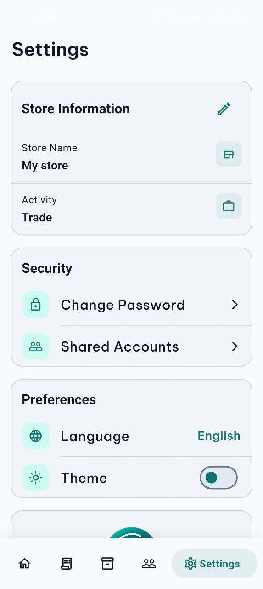 <strong>Settings</strong></td>
    <td></td>
  </tr>
</table>

<strong>🌙 Dark Mode</strong>

 

<table align="center">
  <tr>
    <td align="center"> <strong>Dashboard</strong></td>
    <td align="center">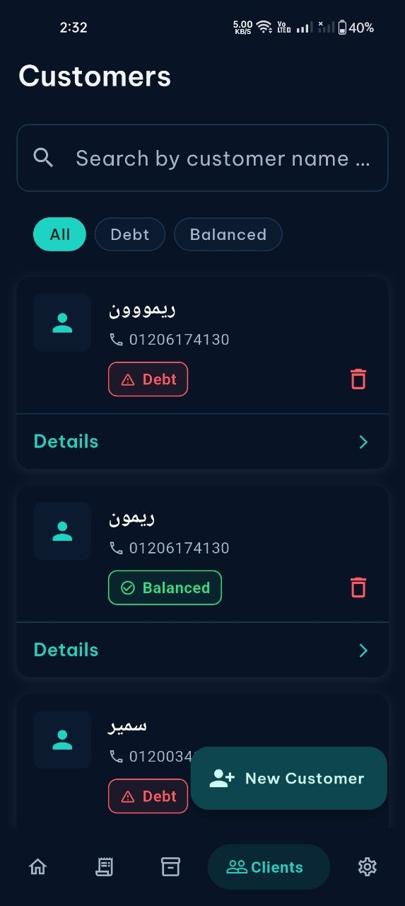 <strong>Clients</strong></td>
    <td align="center">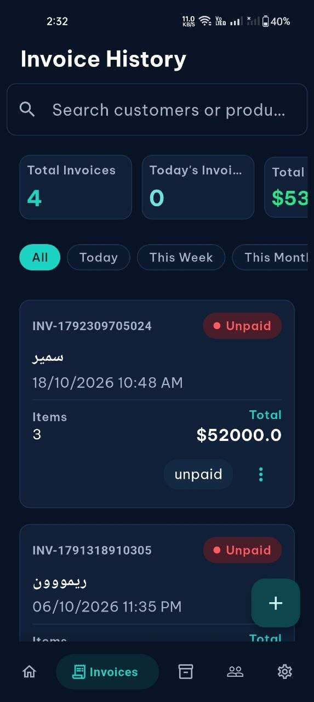 <strong>Invoices</strong></td>
  </tr>
  <tr>
    <td align="center">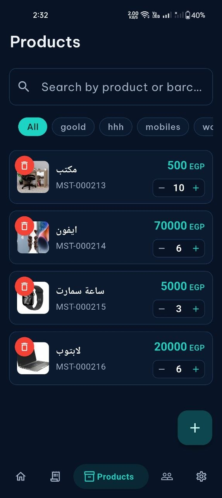 <strong>Products</strong></td>
    <td align="center">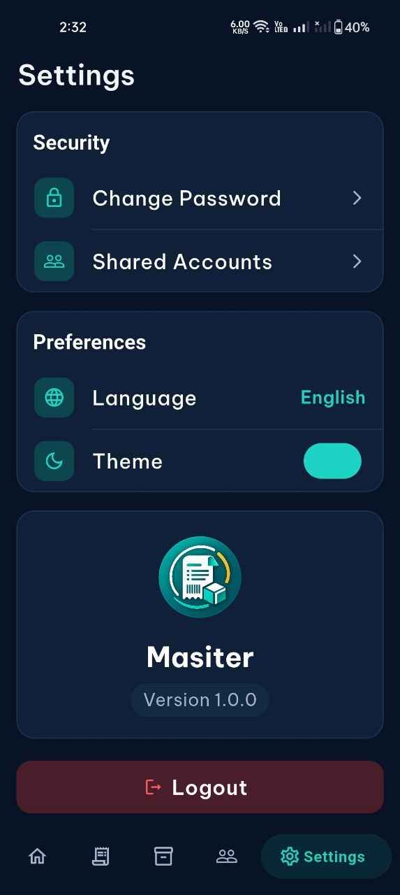 <strong>Settings</strong></td>
    <td></td>
  </tr>
</table>

### Arabic — العربية

<strong>☀️ Light Mode</strong>

 

<table align="center">
  <tr>
    <td align="center"> <strong>Dashboard</strong></td>
    <td align="center"> <strong>Clients</strong></td>
    <td align="center"> <strong>Invoices</strong></td>
  </tr>
</table>

---

## 🖥️ Web

### English

<strong>☀️ Light &nbsp;|&nbsp; 🌙 Dark (side by side)</strong>

 

<table align="center">
  <tr>
    <th align="center">☀️ Light</th>
    <th align="center">🌙 Dark</th>
  </tr>
  <tr>
    <td align="center"> <strong>Dashboard</strong></td>
    <td align="center">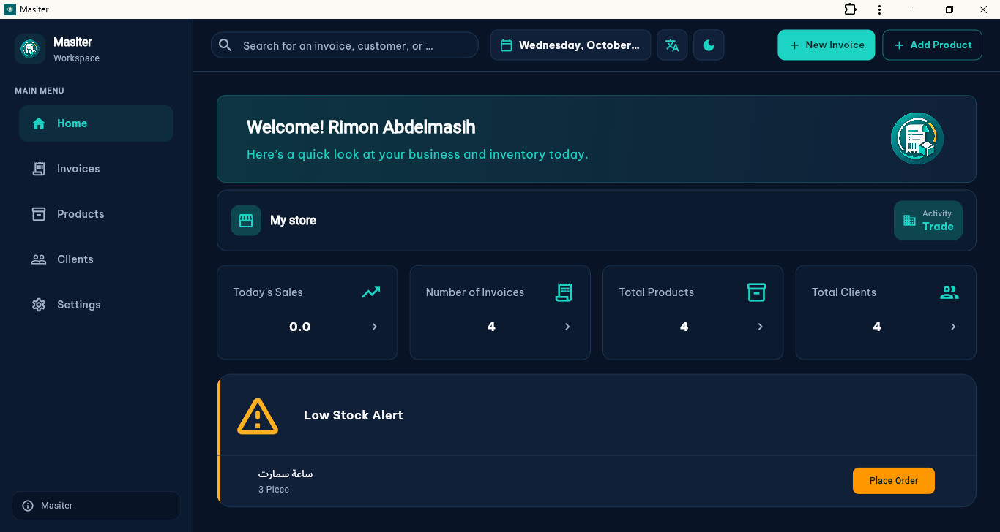 <strong>Dashboard</strong></td>
  </tr>
  <tr>
    <td align="center">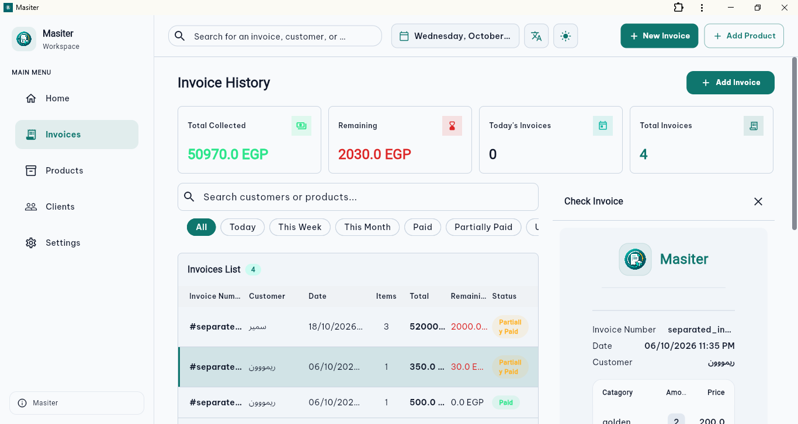 <strong>Invoices</strong></td>
    <td align="center">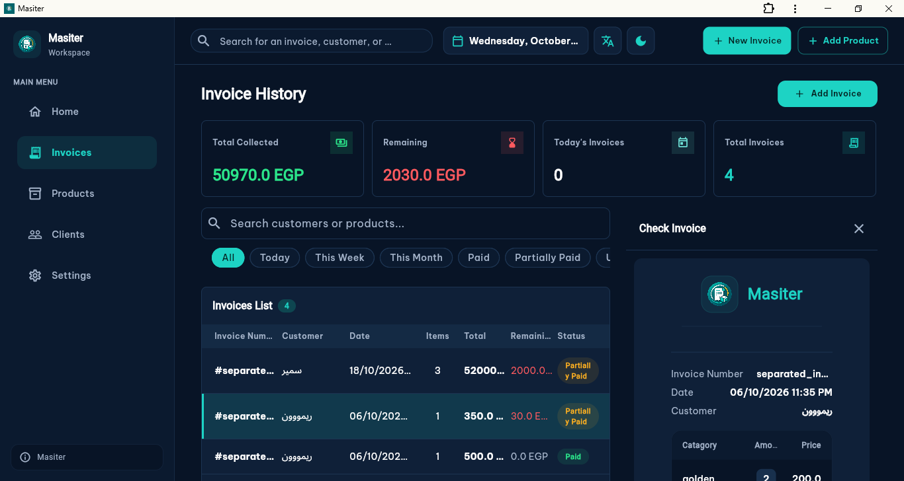 <strong>Invoices</strong></td>
  </tr>
</table>

### Arabic — العربية

<strong>☀️ Light &nbsp;|&nbsp; 🌙 Dark (side by side)</strong>

 

<table align="center">
  <tr>
    <th align="center">☀️ Light</th>
    <th align="center">🌙 Dark</th>
  </tr>
  <tr>
    <td align="center">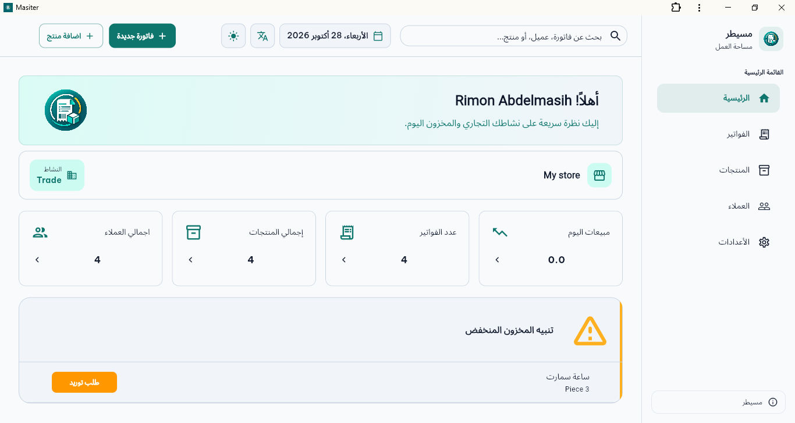 <strong>Dashboard</strong></td>
    <td align="center">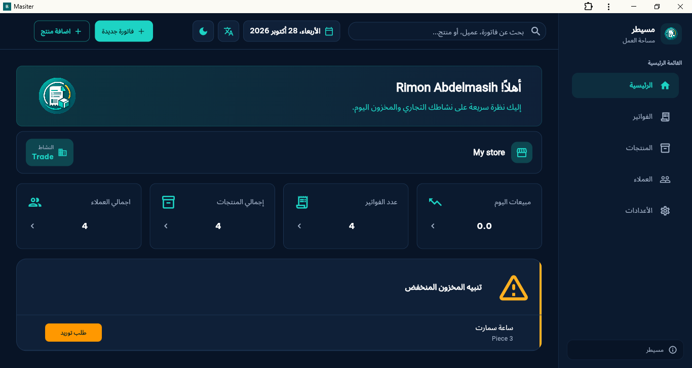 <strong>Dashboard</strong></td>
  </tr>
</table>

---

## Adding screenshots

Files live in `docs/screenshots/<platform>/` and are named `<screen>_<lang>_<theme>.<ext>`, for example `invoices_en_dark.jpg`.

| Part | Values |
|:--|:--|
| **platform** | `mobile` or `web` (web files are prefixed `web_`) |
| **screen** | lowercase English name: `dashboard`, `products`, `invoices`, `clients`, `settings` |
| **lang** | `en` or `ar` |
| **theme** | `light` or `dark` |

**To add one:** drop the file in the matching folder, then add a `<td>` cell under the right platform / language / theme section (mobile `width="220"`, web `width="460"`). Add a new `
` block only when a configuration gets its first screenshot. Do not add placeholders for screenshots that do not exist yet.